 

 

<table>
<tr>
<td width="230" align="center">

</td>
<td>
Bonjour ! Je suis <b>Clara Josephine</b>, étudiante en sciences biologiques appliquées. 
Je m'intéresse à la <b>biologie moléculaire</b>, à la <b>génomique</b> et à la <b>bio-informatique</b> : comprendre le vivant avec des données et du code.
  
🔬 Je travaille sur : l'analyse de séquences et de génomes 
📚 J'apprends : Python, BioPython, analyse de données biologiques 
🎯 Je recherche : un stage / une opportunité en bio-informatique 
💬 Parle-moi de : gènes, protéines, ADN, ou d'un bon notebook Jupyter
</td>
</tr>
</table>

 

 

**Laboratoire :** biologie moléculaire · biochimie · anatomie comparée · botanique

**Informatique :** Python · BioPython · Jupyter Notebook · Git / GitHub

**À venir :** R · analyse RNA-seq · visualisation de données

- [x] Résoudre mes premiers problèmes Rosalind
- [x] Analyser le génome d'*E. coli* K-12
- [ ] Publier un projet d'analyse d'expression génique
- [ ] Un petit commit par semaine

 

 

